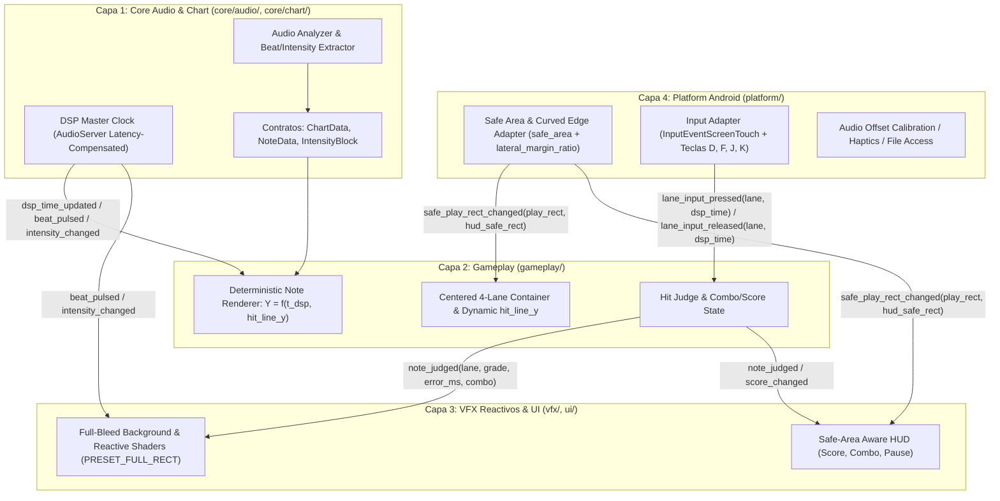

# 00 — Arquitectura por Capas y Contratos de Datos Congelados

## 1. Visión General de la Arquitectura

**FeelYourBeats (FyB)** es un juego de ritmo móvil vertical para Android construido sobre **Godot 4.7.2 Standard** (renderizador `mobile`, resolución base `1080x1920`, `keep_width`, `edge_to_edge=true`).

Para garantizar sincronización musical al sub-milisegundo, adaptación perfecta a pantallas modernas (incluyendo relaciones 20:9 / 1.5K y bordes curvos tipo Moto Edge) y mantenibilidad estricta, el sistema se estructura en **4 capas desacopladas** que se comunican mediante **señales** y **contratos de datos congelados**.

---

## 2. Especificación de las 4 Capas del Sistema

### Capa 1: Core Audio / Chart (`core/audio/`, `core/chart/`)
Responsable del tiempo musical real, el análisis de audio y la estructura inmutable del mapa rítmico (*chart*).
- **Reloj Maestro DSP (`core/audio/`):**
  - Mantiene el tiempo musical autoritativo en segundos (`current_dsp_time_sec: float`) calculado directamente a partir de la posición del `AudioStreamPlayer`, sumando `AudioServer.get_time_since_last_mix()` y restando `AudioServer.get_output_latency()` más el offset de calibración del usuario.
  - Emite señales de pulso rítmico y cambios de bloque de intensidad (`IntensityBlock`) al cruzar sus umbrales temporales.
- **Generación y Carga de Charts (`core/chart/`):**
  - Encapsula el análisis de audio y la construcción/validación de instancias de `ChartData` compuestas por listas ordenadas de `NoteData` e `IntensityBlock`.
- **Aislamiento:** No importa ni referencia ningún nodo de `Control`, `Node2D` de gameplay, shaders ni lógica de entrada táctil.

---

### Capa 2: Gameplay (`gameplay/`)
Responsable del espacio jugable de 4 carriles, el posicionamiento determinístico de notas y la evaluación de precisión (*Judge*).
- **Contenedor Centrado con Margen Lateral para Pantallas Curvas (`lateral_margin_ratio`):**
  - Los 4 carriles (`lane 0..3`) ocupan el 100% del alto del viewport pero se alojan en un contenedor centrado horizontalmente.
  - Este contenedor aplica un margen lateral de seguridad configurable (`lateral_margin_ratio: float = 0.06` por defecto en cada borde, combinado con el `safe_area` horizontal reportado por la Capa 4).
  - Esto protege al jugador contra toques fantasma con la palma en pantallas con bordes curvos pronunciados (tipo Moto Edge) y evita activar por accidente el gesto *Atrás* del sistema Android al tocar los carriles exteriores (`0` y `3`).
- **Cálculo Dinámico de `hit_line_y` (Cero Coordenadas `Y` Fijas):**
  - Dado que `stretch/aspect="keep_width"` mantiene el ancho base en `1080` mientras el alto virtual varía según la relación de aspecto del dispositivo (`get_viewport_rect().size.y`), queda prohibido usar un valor fijo en píxeles para la línea de impacto.
  - `hit_line_y` se calcula dinámicamente en función del alto actual del viewport (por ejemplo: `hit_line_y = viewport_size.y * hit_line_height_ratio`, respetando el margen inferior del `safe_area`).
- **Movimiento Determinístico de Notas:**
  - Prohibido mover notas con `_process(delta)`.
  - En cada frame de renderizado, la coordenada `Y` de cada nota visible se calcula como función pura del reloj DSP:
    $$Y(t_{\text{dsp}}) = y_{\text{hit\_line}} - (t_{\text{nota}} - t_{\text{dsp}}) \cdot v_{\text{scroll}}$$
- **Sistema de Juicio (Judge):**
  - Compara el timestamp `t_dsp` del evento de entrada del carril contra `NoteData.time_sec` (y `duration_sec` para notas *hold*), clasificando el impacto y emitiendo señales hacia `vfx/` y `ui/`.

---

### Capa 3: VFX Reactivos y UI (`vfx/`, `ui/`)
Responsable de la respuesta visual, shaders reactivos y HUD informativo.
- **Separación Full-Bleed para VFX (`vfx/`):**
  - El fondo visual y las capas de shaders reactivos utilizan `PRESET_FULL_RECT` cubriendo el **100% del viewport real** (incluyendo la zona de cámara frontal, bordes curvos y barra inferior gracias a `window/size/edge_to_edge=true`).
  - Reaccionan exclusivamente a señales emitidas por la Capa 1 (energía/tier de `IntensityBlock`, pulsos de beat) y la Capa 2 (impactos en carriles, racha de combo).
  - **Prohibido** ejecutar lectura de buses de audio, FFT o cálculos DSP dentro de nodos visuales o shaders.
- **HUD y Controles Superiores (`ui/`):**
  - Los elementos interactivos e informativos superiores (botón de pausa, marcador de score, barra de progreso) se posicionan respetando el `safe_area` vertical provisto por la Capa 4 para nunca quedar ocultos tras la cámara frontal (*punch-hole* / *notch*).

---

### Capa 4: Platform Android (`platform/`)
Responsable de abstraer el hardware móvil Android y la paridad de pruebas en escritorio (PC).
- **Gestión de `safe_area` Vertical y Horizontal:**
  - Consulta `DisplayServer.get_display_safe_area()` y transforma las coordenadas físicas de pantalla al espacio de coordenadas del viewport activo (`get_viewport_rect()`).
  - **Vertical:** Calcula los márgenes seguros superior (cámara frontal / barra de estado en modo `edge_to_edge`) e inferior (barra de gestos de navegación) para alimentar al HUD (`ui/`) y al límite inferior de `gameplay/`.
  - **Horizontal:** Combina el `safe_area` horizontal del sistema con `lateral_margin_ratio` (por defecto `0.06` del ancho del viewport por lado) para definir el rectángulo táctil seguro de los 4 carriles.
- **Adaptador de Entrada Unificado (Multitouch + Teclado PC):**
  - En Android: Procesa `InputEventScreenTouch` (soportando múltiples dedos simultáneos mediante `event.index`) dentro de los límites horizontales de cada uno de los 4 carriles en la zona táctil segura.
  - En PC: Mapea las teclas físicas `D`, `F`, `J`, `K` a los carriles `0`, `1`, `2`, `3` respectivamente.
  - Estampa cada evento de entrada con la lectura inmediata del reloj maestro DSP y emite la señal normalizada hacia `gameplay/`.

---

## 3. Contratos de Datos Congelados

Los siguientes contratos definen la estructura inmutable de intercambio entre `core/chart/`, `core/audio/`, `gameplay/` y `vfx/`. Cuando se implementen en GDScript, deberán extender `Resource` (o `RefCounted`) con **tipado estático estricto**.

### 3.1. `NoteData`
Representa una nota individual dentro de un carril del chart.

| Campo | Tipo GDScript | Restricciones / Semántica |
| :--- | :--- | :--- |
| `time_sec` | `float` | `>= 0.0`. Timestamp exacto del impacto en segundos respecto al inicio del stream de audio. |
| `lane` | `int` | Rango `0..3` (`0` = carril izquierdo / tecla `D`, `3` = carril derecho / tecla `K`). |
| `duration_sec` | `float` | `>= 0.0`. `0.0` indica nota simple (*tap*); `> 0.0` indica nota sostenida (*hold*). |
| `strength` | `float` | Rango normalizado `0.0..1.0`. Intensidad o acento rítmico del onset para feedback visual/háptico. |

---

### 3.2. `IntensityBlock`
Representa un segmento temporal de la canción con un nivel de energía musical homogéneo, utilizado para modular los VFX reactivos sin que la capa visual procese audio.

| Campo | Tipo GDScript | Restricciones / Semántica |
| :--- | :--- | :--- |
| `start_sec` | `float` | `>= 0.0`. Tiempo de inicio del bloque en segundos. |
| `end_sec` | `float` | `> start_sec`. Tiempo de fin del bloque en segundos. |
| `energy` | `float` | Rango normalizado `0.0..1.0`. Energía media RMS/espectral del segmento. |
| `tier` | `int` | Rango `0..3`. Nivel discreto de intensidad (`0 = Calm`, `1 = Groove`, `2 = High`, `3 = Peak/Drop`). |

---

### 3.3. `ChartData`
Contrato contenedor raíz que agrupa los metadatos de la pista, la secuencia completa de notas y el mapa de intensidad energética.

| Campo | Tipo GDScript | Restricciones / Semántica |
| :--- | :--- | :--- |
| `song_id` | `String` | Identificador único o hash determinístico de la pista de audio. |
| `title` | `String` | Título legible de la canción. |
| `audio_path` | `String` | Ruta al archivo de audio (`res://` o `user://`). |
| `duration_sec` | `float` | `> 0.0`. Duración total del stream de audio en segundos. |
| `bpm_estimate` | `float` | `> 0.0`. Tempo estimado en pulsos por minuto (BPM) de referencia. |
| `offset_sec` | `float` | Offset base del chart en segundos. |
| `notes` | `Array[NoteData]` | Lista de notas ordenada estrictamente de forma ascendente por `time_sec`. |
| `intensity_blocks` | `Array[IntensityBlock]` | Lista de bloques de intensidad contiguos y ordenados por `start_sec`. |

---

## 4. Invariantes de Validación de Contratos
1. **Orden Temporal:** Todo `ChartData` válido garantiza que `notes[i].time_sec <= notes[i + 1].time_sec` y `intensity_blocks[i].end_sec <= intensity_blocks[i + 1].start_sec`.
2. **No Solapamiento en Mismo Carril:** En un mismo `lane` (`0..3`), ninguna nota puede iniciar antes de que termine el `time_sec + duration_sec` de la nota previa en ese mismo carril.
3. **Inmutabilidad en Gameplay:** Una vez entregado un `ChartData` a las capas `gameplay/` y `vfx/`, sus arreglos `notes` e `intensity_blocks` se tratan como de solo lectura.
